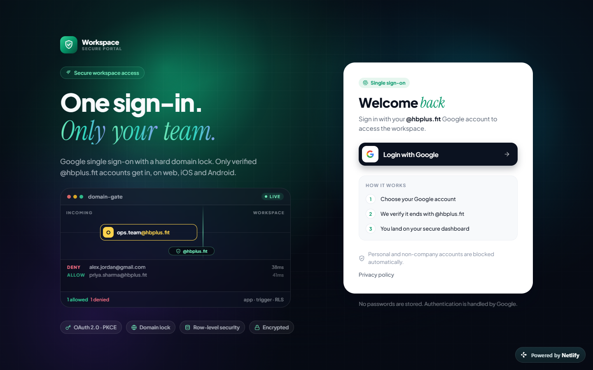
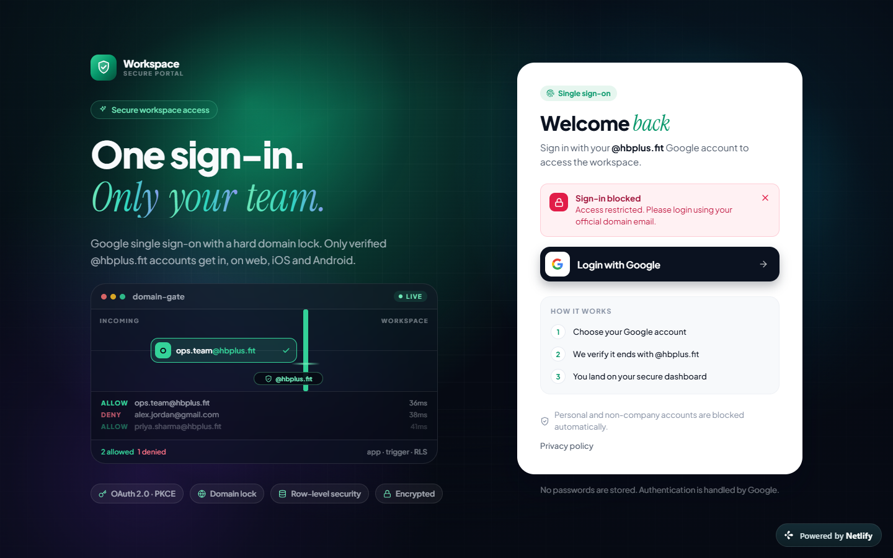
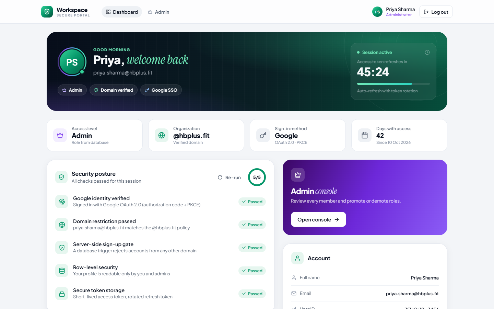
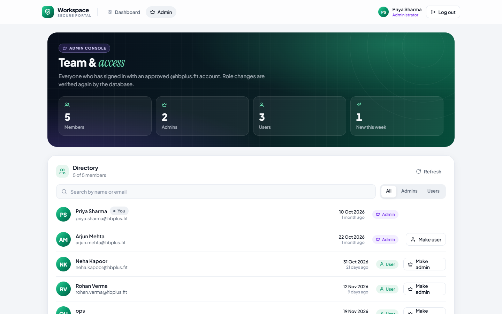
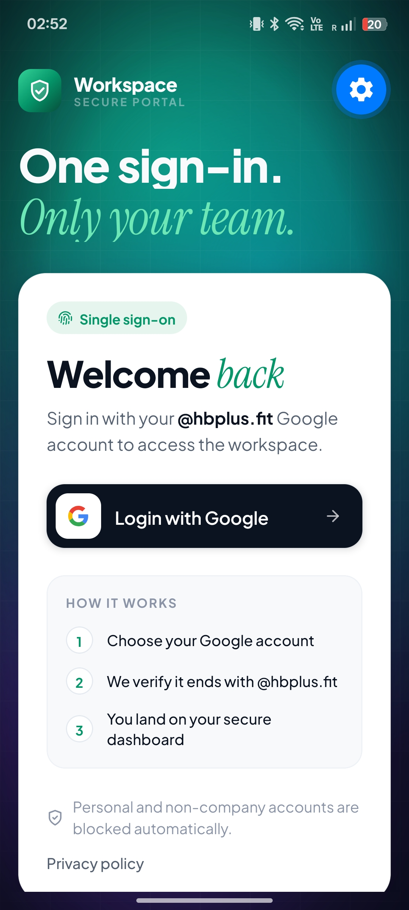
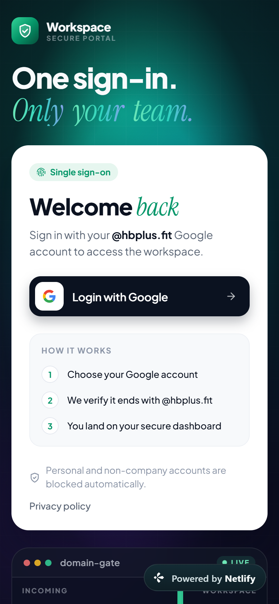
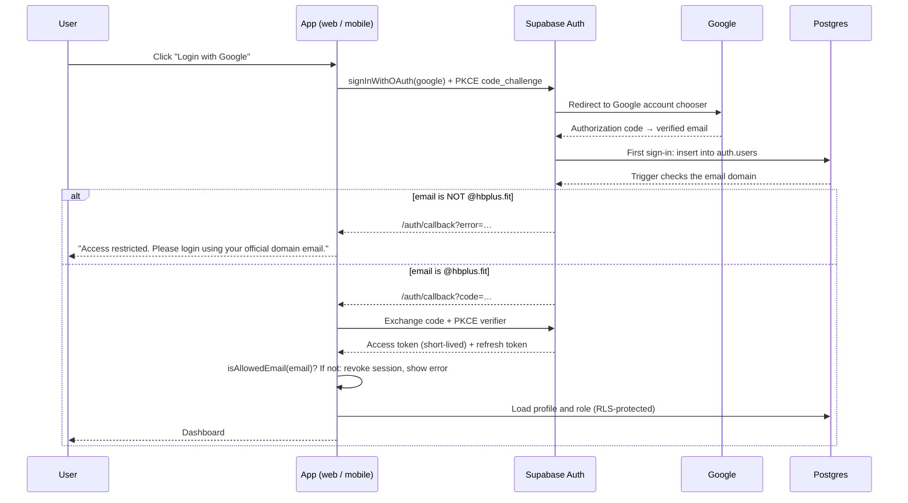

# Workspace Portal: domain-restricted Google sign-in (React Native + Web)

A cross-platform app built from **one React Native codebase** that runs on **Android, iOS and the web**.
Users sign in with **Google OAuth 2.0**, and only accounts on the allowed domain
(`@hbplus.fit` by default) can get in. Every other account sees:

> **Access restricted. Please login using your official domain email.**

**Live demo:** [workspace-portal-govindtech.netlify.app](https://workspace-portal-govindtech.netlify.app)

## Screenshots

| Login | Non-domain account blocked |
|---|---|
|  |  |

| Dashboard (Admin) | Admin console |
|---|---|
|  |  |




Left: the same codebase running natively on an Android phone (Expo Go). Right: the web build on a phone-sized screen.

Login and the blocked-account screens are from the live site. Dashboard and Admin show sample data.

| Requirement | Where it lives |
|---|---|
| Google Sign-In button | [`src/components/GoogleButton.tsx`](src/components/GoogleButton.tsx) |
| Domain validation logic | [`src/auth/domain.ts`](src/auth/domain.ts) (client), [`supabase/schema.sql`](supabase/schema.sql) (server) |
| Protected Dashboard page | [`src/app/(app)/dashboard.tsx`](src/app/(app)/dashboard.tsx) |
| Logout | `signOut()` in [`src/auth/AuthProvider.tsx`](src/auth/AuthProvider.tsx), button in [`TopBar`](src/components/TopBar.tsx) |
| Loading state | "Signing in…" button state, session-restore loader, callback loader |
| Error handling | [`src/auth/errors.ts`](src/auth/errors.ts) maps every failure to a clear message |
| **Bonus:** roles (Admin / User) | `profiles.role`, admin-only route [`src/app/(app)/admin.tsx`](src/app/(app)/admin.tsx) |
| **Bonus:** user data in a database | `public.profiles` table in Supabase Postgres |
| **Bonus:** properly protected routes | `Stack.Protected` guards in [`src/app/_layout.tsx`](src/app/_layout.tsx), plus Row Level Security in the database |

---

## Design

- **Login:**
  - The headline rises word by word out of a mask, with an Instrument Serif italic accent.
  - The signature **Domain Gate** animation ([`DomainGate.tsx`](src/components/DomainGate.tsx)) shows
    the domain rule in action. Email tokens glide to a scanning gate. Allowed domains pass into the
    workspace, and the rest shake, turn red and drop away, with a live allow / deny log.
  - Drifting aurora glows, a cursor-following spotlight, film grain, and a 3D tilt on the login card
    that follows the cursor.
  - A light sweep on the Google button, the domain "decoding" from scrambled characters, and a shake
    on error.
- **Loading:** the shield logo draws itself, then its check mark ([`AnimatedLogo.tsx`](src/components/AnimatedLogo.tsx)).
- **Dashboard:**
  - Hero with an orbiting gradient ring around the avatar, a periodic light sweep, and a **live
    token-refresh countdown**.
  - Count-up stats, and cards that lift on hover.
  - A **live security scan** ([`SecurityScan.tsx`](src/components/SecurityScan.tsx)). Each check goes
    pending → checking → passed with a pop while the score ring draws itself. **Re-run** replays it.
- **Admin console:** count-up stats, staggered rows, a badge pop on role change, search and filters.
- **System:**
  - All motion is built on React Native `Animated` ([`Motion.tsx`](src/components/Motion.tsx)),
    using the native driver on iOS / Android.
  - Web-only touches (spotlight, grain, tilt) switch off on native.
  - Plus Jakarta Sans with Instrument Serif accents, a custom SVG icon set, and one theme file
    ([`src/theme.ts`](src/theme.ts)).

## Tech stack

- **Expo SDK 58** (React Native 0.88, React 19) with **React Native for Web**
- **Expo Router**: file-based routing that works on native and web
- **Supabase Auth** (Google provider, OAuth 2.0 authorization-code flow with **PKCE**)
- **Supabase Postgres**: profiles, roles, Row Level Security, sign-up trigger
- `expo-web-browser` (secure system browser for native sign-in), `expo-secure-store` + AES (encrypted token storage)
- TypeScript (strict), Jest (`jest-expo`)
- **Netlify** for the web deployment

## Folder structure

```
src/
  app/                      # Routes (Expo Router), one file per screen
    _layout.tsx             # Root: AuthProvider + route guards (Stack.Protected)
    index.tsx               # "/" → /dashboard or /login
    login.tsx               # Login page
    auth/callback.tsx       # OAuth return URL (web + native deep link)
    (app)/_layout.tsx       # Signed-in shell (top bar) + admin role guard
    (app)/dashboard.tsx     # Protected dashboard
    (app)/admin.tsx         # Admin-only team directory and role management
    +not-found.tsx
  auth/
    AuthProvider.tsx        # Session state, domain gate, sign-in / sign-out
    domain.ts               # isAllowedEmail(), the single domain rule
    errors.ts               # OAuth redirect parsing, user-friendly error messages
    googleOAuth.ts          # Web sign-in (full-page redirect)
    googleOAuth.native.ts   # iOS/Android sign-in (system browser + deep link)
    __tests__/domain.test.ts
  components/               # GoogleButton, TopBar, Card, Badge, Avatar, ...
  config/env.ts             # Typed access to EXPO_PUBLIC_* variables
  lib/
    supabase.ts             # Supabase client (PKCE, auto refresh)
    authStorage.ts          # Web token storage
    authStorage.native.ts   # Encrypted native token storage (Keychain/Keystore + AES)
  theme.ts                  # Colors, spacing, typography, breakpoints
supabase/schema.sql         # Tables, RLS policies, domain trigger, role RPC
netlify.toml                # Build command, SPA redirect, security headers
```

---

## Setup

### Prerequisites
- Node.js 20 or newer
- A free [Supabase](https://supabase.com) project
- A [Google Cloud](https://console.cloud.google.com) project
- For mobile: the **Expo Go** app on a phone, or an Android emulator / iOS simulator

### 1. Create Google OAuth credentials
1. Google Cloud Console → **APIs & Services → OAuth consent screen**: configure it (External or Internal), app name, support email.
2. **Credentials → Create credentials → OAuth client ID → Web application**.
3. **Authorized redirect URIs**: add `https://<your-project-ref>.supabase.co/auth/v1/callback`
   (shown in Supabase under Authentication → Providers → Google).
4. Copy the **Client ID** and **Client secret**.

### 2. Configure Supabase
1. **Authentication → Providers → Google**: enable it and paste the Client ID and Client secret.
2. **Authentication → URL Configuration**:
   - **Site URL**: your Netlify URL (or `http://localhost:8081` while developing)
   - **Redirect URLs** (add all):
     ```
     http://localhost:8081/**
     https://<your-site>.netlify.app/**
     domainauth://**
     exp://**
     ```
3. **SQL Editor**: paste and run [`supabase/schema.sql`](supabase/schema.sql).
4. Make yourself an admin (optional): run this in the SQL Editor:
   ```sql
   insert into public.admin_emails (email) values ('you@hbplus.fit') on conflict do nothing;
   -- or, if you have already signed in once:
   update public.profiles set role = 'admin' where email = 'you@hbplus.fit';
   ```

### 3. Environment variables
```bash
cp .env.example .env
```
| Variable | Value |
|---|---|
| `EXPO_PUBLIC_SUPABASE_URL` | Supabase → Project Settings → API → Project URL |
| `EXPO_PUBLIC_SUPABASE_KEY` | The **publishable** key (`sb_publishable_…`), or the legacy `anon` key. **Never the secret / service_role key.** |
| `EXPO_PUBLIC_ALLOWED_EMAIL_DOMAIN` | `hbplus.fit` (must match `public.allowed_email_domain()` in the SQL) |
| `EXPO_PUBLIC_ALLOWED_TEST_EMAILS` | Optional, comma-separated off-domain test addresses. Each must also be a row in `public.allowed_emails`. Leave empty in production. |

If a variable is missing, the app shows a "Configuration required" screen instead of crashing.

### 4. Run it
```bash
npm install
npm run web        # browser at http://localhost:8081
npm start          # scan the QR code with Expo Go (Android / iOS)
npm run android    # Android emulator
npm run ios        # iOS simulator (macOS only)
```

Quality checks:
```bash
npm test           # domain-validation and OAuth-error unit tests
npm run typecheck
npm run build:web  # production web build in dist/
```

### 5. Deploy to Netlify
1. Push this repository to GitHub.
2. Netlify → **Add new site → Import an existing project** → pick the repo.
   Build settings are read from [`netlify.toml`](netlify.toml) (`npx expo export --platform web` → `dist`).
3. **Site configuration → Environment variables**: add the three `EXPO_PUBLIC_*` variables.
   They are inlined at build time, so trigger a redeploy after changing them.
4. Add the Netlify URL to Supabase **Site URL** and **Redirect URLs** (step 2).

---

## Authentication flow



**Web.** The browser does a full-page redirect to Google and comes back to `/auth/callback?code=…`.
`supabase-js` exchanges the code automatically (`detectSessionInUrl`).

**iOS / Android.** [`googleOAuth.native.ts`](src/auth/googleOAuth.native.ts) opens Google in a
**secure system browser session** (ASWebAuthenticationSession / Chrome Custom Tabs, never an
embedded WebView, which Google blocks). The browser returns to the app through a deep link
(`exp://…/--/auth/callback` in Expo Go, `domainauth://auth/callback` in a build), and the app
exchanges the code with `exchangeCodeForSession`. This works in **Expo Go** with no native
Google SDK.

**Loading states.** "Signing in…" on the button. "Checking your session…" while a stored session
is restored. "Completing sign-in…" on the callback route.

**Logout.** `supabase.auth.signOut()` revokes the refresh token on the server, and local tokens
are always cleared, even if the network call fails. The guards then send the user to `/login`.

## How domain restriction works

The rule is an **exact, case-insensitive match** on the part after the single `@`:

| Email | Result |
|---|---|
| `example@hbplus.fit`, `Example@HBPLUS.fit` | ✅ allowed |
| `example@gmail.com` | ❌ restricted |
| `example@hbplus.fit.evil.com` (look-alike) | ❌ restricted |
| `example@mail.hbplus.fit` (subdomain) | ❌ restricted |
| `example@gmail.com@hbplus.fit` (spoof) | ❌ restricted |

It is enforced in **layers**, so bypassing the UI does not get anyone in:

1. **Client gate.** [`AuthProvider.applySession`](src/auth/AuthProvider.tsx) runs on every session the
   app sees (initial restore, OAuth return, token refresh). If `isAllowedEmail()` fails, the
   session is revoked **before** it reaches React state, so no protected screen ever renders,
   and the user sees the restriction message.
2. **Server gate (sign-up trigger).** `on_auth_user_created` in [`schema.sql`](supabase/schema.sql)
   raises an error for non-domain emails. The account is never created and **no tokens are issued**.
   Supabase then redirects back with `error_description=Database error saving new user`, which
   [`errors.ts`](src/auth/errors.ts) maps to the restriction message.
3. **Data gate (Row Level Security).** A `RESTRICTIVE` policy on `profiles` requires the JWT
   email to be on the allowed domain, in addition to the normal "own row / admin" policies.
   Even a hand-crafted API call with some other valid token reads nothing.

The domain lives in two places that must match: `EXPO_PUBLIC_ALLOWED_EMAIL_DOMAIN` (client) and
`public.allowed_email_domain()` (database).

**Test accounts.** To let one specific off-domain address in (for example a personal Gmail used
for testing), add it to the database allowlist, which all three layers above check:

```sql
insert into public.allowed_emails (email) values ('tester@gmail.com') on conflict do nothing;
```

and list it in `EXPO_PUBLIC_ALLOWED_TEST_EMAILS` so the client gate lets it through too. Delete the
row and clear the variable to remove it. Only exact addresses match; nothing else on that domain gets in.

## Security notes

- **Protected routes.** `Stack.Protected` removes guarded screens from the navigator.
  Opening `/dashboard` or `/admin` directly while signed out redirects to `/login`.
  `/admin` also requires `role = admin`, otherwise the user is redirected to `/dashboard`.
  Until the stored session has been checked, the app renders only a loader, so protected
  content never flashes.
- **Client guards are UX, not the security boundary.** The JavaScript bundle is public, like
  any SPA, and holds no secrets. All data is protected server-side by RLS, and role changes go
  through `set_user_role()`, which re-checks that the caller is an admin.
- **Token handling.**
  - Authorization-code flow with **PKCE**: no tokens appear in URLs. The one-time code is useless
    without the verifier kept on the device.
  - Short-lived access tokens, automatic refresh with refresh-token rotation. On mobile,
    refresh pauses while the app is in the background.
  - **Native:** the session is AES-256 encrypted, and the key is kept in the iOS Keychain /
    Android Keystore (`expo-secure-store`). Nothing is stored in plain text.
  - **Web:** `localStorage`, the standard for a static SPA with no server to set httpOnly cookies.
    Risk is reduced by PKCE, short token lifetime, no third-party scripts, and the security
    headers in `netlify.toml`: a strict **Content-Security-Policy** (only our own scripts run, and the
    app can only call Supabase), plus `X-Frame-Options`, `nosniff` and HSTS.
  - Only the **publishable** key ships in the app. The secret key is never used client-side.
  - Signed-out visitors cannot call the database helper functions (`email_is_allowed`, `is_admin`)
    through the API, so the allowlist and roles can't be probed from outside.
- **State management.** One `AuthProvider` (React Context) is the single source of truth for
  `status`, `session`, `profile`, `role`, loading flags and errors. Screens read it through `useAuth()`.

## Roles (Admin / User)

- New users get `role = 'user'`. Emails listed in `public.admin_emails` become `admin` on first sign-in.
- **User:** dashboard and their own profile.
- **Admin:** also `/admin`, a list of all members, where they can promote or demote other members.
  Admins cannot change their own role.

## Testing checklist

| Scenario | Expected |
|---|---|
| Sign in with `name@hbplus.fit` | Redirected to the Dashboard with profile and role |
| Sign in with `name@gmail.com` | Back on Login with "Access restricted. Please login using your official domain email." |
| Open `/dashboard` while signed out | Redirected to `/login` |
| Open `/admin` as a normal user | Redirected to `/dashboard` |
| Click Logout, then press Back or open `/dashboard` | Stays on `/login` |
| Refresh the page while signed in | Session restored, stays on the Dashboard |
| Cancel on the Google screen | "Google sign-in was cancelled" message, button re-enabled |

Automated: `npm test` runs 23 unit tests covering the domain rule (including look-alike and
spoofed addresses) and the OAuth error mapping.
